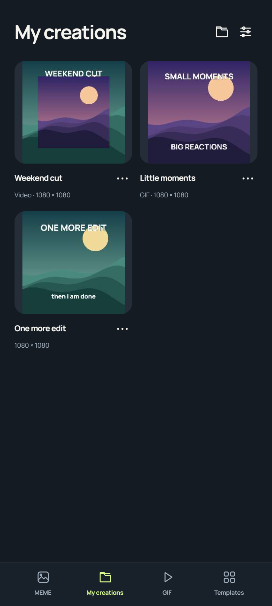
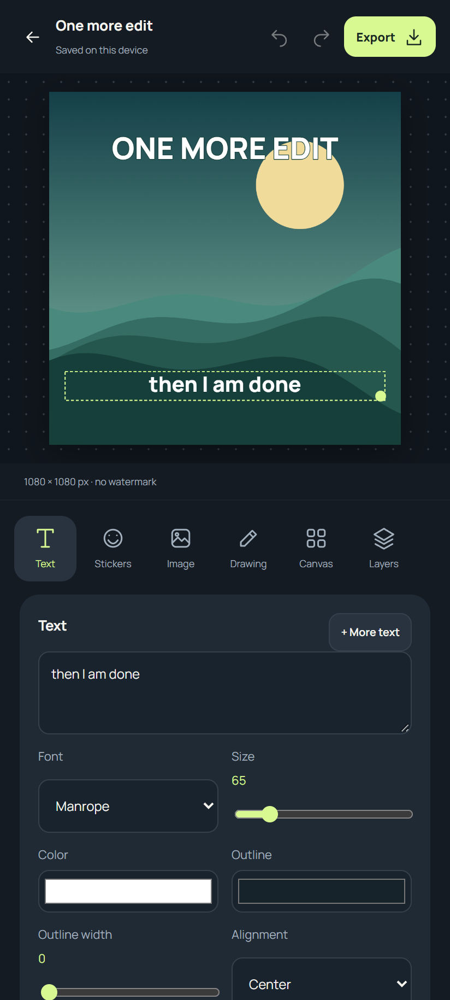
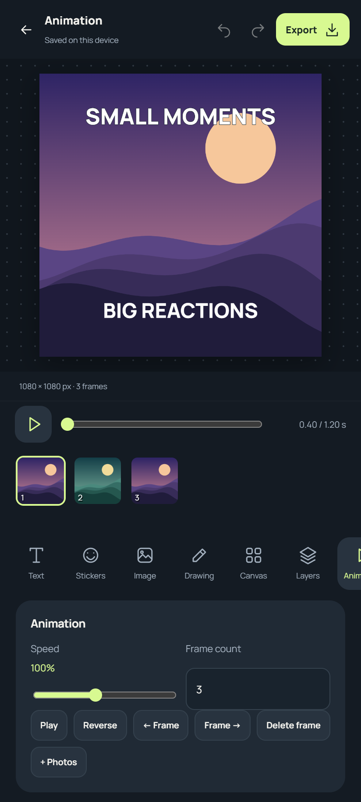
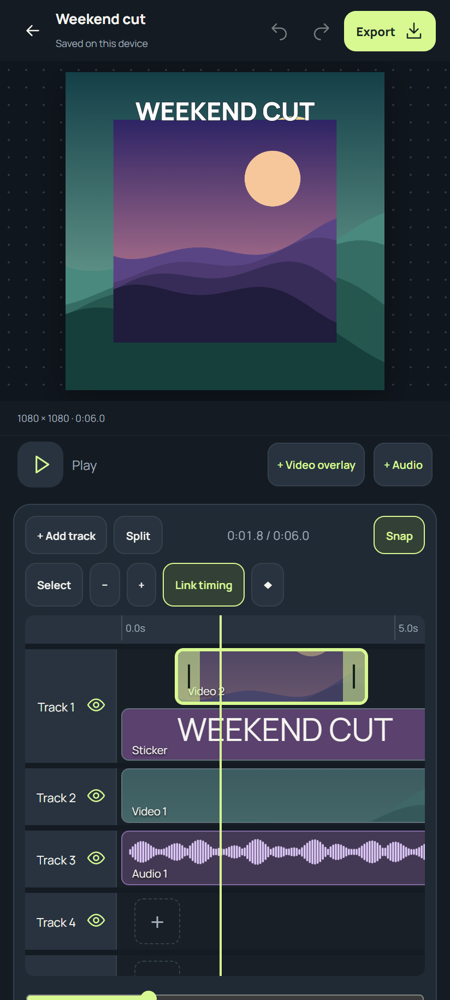

<h1 align="center">Iskrio</h1>
<p align="center"><strong>Make memes. Cut videos. Create GIFs. Keep your work local.</strong></p>
<p align="center">Android 8.0+ · Portrait editor · Java + JavaScript · Version 2.7.1</p>

Iskrio is an open-source Android creative studio with meme, image, GIF, video and audio editing in one app. Editing, playback, rendering and export run on the device. There are no ads, accounts, subscriptions, app watermarks or AI tools.

Optional **Import link** downloads supported public media only after you turn on the app's Internet access switch. The importer closes its network session and turns the switch off before local processing. The first developer build needs Internet access to obtain its dependencies.

## Screenshots

<table>
<tr><th>My creations</th><th>Meme editor</th><th>GIF editor</th><th>Track editor</th></tr>
<tr>
<td></td>
<td></td>
<td></td>
<td></td>
</tr>
</table>

These UI captures are rendered from the unmodified app web assets with original demo artwork. Android font rendering and available screen space may differ. No imported social-media posts or personal projects are shown.

## What you can make

- **Memes and images:** text, stickers, shapes, drawing, filters, color-key removal, charts, collages, canvas sizes and editable layers.
- **GIFs:** import original frames, timing, transparency and loops; change speed, reverse, reorder, remove frames and add overlays. Unchanged new GIF-editor imports can export the original GIF byte for byte.
- **Video timelines:** five starting Tracks, up to 20 Track containers, multiple items in a Track, trim, Split, duplicate, move, Freeze and Undo/Redo. Track 1 is the upper main layer.
- **Video adjustments:** crop directly in the preview, rotation/flips, fitting, fades, filters, local blur/pixelation regions, stabilization, speed changes, speed ramps and reverse. Sequence projects support nine transitions.
- **Audio:** waveform items inside Tracks, trim/Split, placement, volume, fades, pitch, EQ, noise reduction, normalization, effects, voiceover and timing-preserving detachment from ramped/reversed clips.
- **Motion and overlays:** timed text, stickers, keyframes, subtitles/SRT, up to three dedicated video overlays, circle masks and chroma key.
- **Exports:** MP4, GIF, PNG, JPEG, AAC/M4A, MP3, WAV and editable project/library backups. Export dimensions follow the project canvas automatically within encoder limits.

Templates start empty: add and reuse your own images. Projects and imported media stay in app-private storage; portable backups let you move editable work between installations.

## Run the project

Requirements:

- Android Studio with **JDK 25** available for the Gradle daemon; Java source compatibility is 17.
- Android SDK **Platform 37** and **Build Tools 36.0.0**.
- A **64-bit ARM or x86_64** device/emulator running Android 8.0 / API 26 or later. 32-bit-only devices are unsupported.
- An up-to-date Android System WebView.

1. Clone or download this repository and open its root folder in Android Studio.
2. Select JDK 25 for Gradle and allow Gradle Sync to download dependencies.
3. Install the requested SDK components if prompted.
4. Select the `app` configuration and run it on your device or emulator.

The committed Gradle wrapper pins Gradle 9.6.0; the build uses AGP 9.4.1. Android Studio creates your own `local.properties`. No machine-specific SDK path or signing key is included.

From a terminal:

```sh
# macOS / Linux
bash ./gradlew assembleDebug testDebugUnitTest lintDebug

# Windows PowerShell
.\gradlew.bat assembleDebug testDebugUnitTest lintDebug
```

The debug APK is generated at `app/build/outputs/apk/debug/app-debug.apk`. For a signed, non-debuggable release build, see [release instructions](docs/RELEASE.md). Keep keys and passwords outside Git.

## Tests

```sh
# Node.js 18+; no npm packages required
node tools/test-js.mjs
```

Version 2.7.1 passed **62 JVM tests**, **7 JavaScript suites**, lint with zero errors and focused Android-emulator regressions for subtitle validation, backup restoration, rotated framing, Freeze with following audio and transformed audio detachment. The browser/editor smoke checks also passed. This is recorded verification, not a claim that every codec, device or combination works.

See [testing](docs/TESTING.md) for scope and optional native integration checks.

## Limits and current caveats

| Area | Limit / behavior |
| --- | --- |
| Complete video timeline | 10 minutes |
| Video/audio input | 10 minutes and 1 GiB per file |
| Main timeline | 20 video/photo items, 20 audio items, up to 20 Tracks |
| Dedicated overlays | 3 video overlays; up to 24 rasterized graphic layers in native export |
| Original GIF import | 40 MiB, 900 frames, 2048 px per side; decoded-pixel/storage budgets apply |
| GIF from a video composition | 30 seconds, 30 FPS, 40 MiB |
| Native video/audio output | 1 GiB |
| Portable media backup | 2 GiB total; 2581 entries including metadata |
| Library | 60 projects and 100 personal templates; metadata size bounds apply |

Advanced effects can require a locally composed preview. Large/reversed/high-resolution projects need more working storage and processing time. Physical ARM hardware and the oldest supported Android version were not retested for 2.7.0.

Original-byte GIF export applies to unchanged GIF-editor imports. GIFs placed in video Tracks are converted to video assets, and edited GIF/video compositions involve encoding. GIF has binary transparency and a 256-color palette per frame.

Link import depends on a public downloadable source. Authentication, private posts, DRM, some streaming formats and external service changes can prevent import. Audio-only MP4 import requires supported AAC sample indexing and byte-range support; it does not silently download a full video as fallback.

## Privacy and permissions

Only `INTERNET` and `RECORD_AUDIO` are requested. Files are selected through Android's document picker; broad storage permission is not requested. Microphone permission is used for explicit local recording. The Internet switch is an application-level gate, not an Android firewall or temporary permission revocation.

See [privacy and permissions](docs/PRIVACY.md).

## Project layout

```text
app/src/main/java/       Android bridge, media storage, import and native rendering
app/src/main/assets/     Offline editor UI, JavaScript, styles, font and notices
app/src/test/            JVM tests, JavaScript tests and small synthetic fixtures
app/src/androidTest/     Native audio-range integration runner
app/src/main/res/        Android styles and app icon
gradle/                 Gradle wrapper and daemon JVM criteria
docs/                   Build, privacy, licensing and test documentation
tools/test-js.mjs       Dependency-free JavaScript test runner
```

## Contributing

Bug reports, reproducible test cases and focused improvements are welcome. Read [CONTRIBUTING.md](CONTRIBUTING.md). Keep editing/export local and preserve the existing limits, privacy controls and undoable workflows.

## License

Iskrio-authored source retains its [MIT license](LICENSE). The app links the GPL-enabled FFmpegKit engine, so the **combined distributed application is GPL version 3**, with dependency notices and source-access requirements. This is not an MIT-only APK.

Read [LICENSING.md](LICENSING.md), [COPYING-GPL-3.0.txt](COPYING-GPL-3.0.txt) and [native source information](docs/FFMPEG-SOURCES.md). Dependencies and the Manrope font retain their own licenses. APKs and the separate native build-source archive belong in release assets, not the Git source tree.
